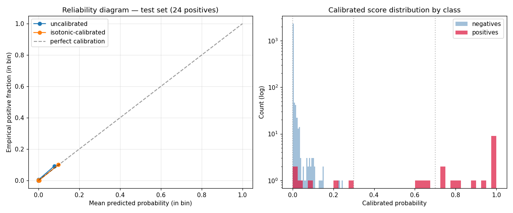

# Calibration Report

Isotonic regression wrapper on the primary LightGBM, fitted via internal 5-fold CV on the train pool. No test-set leak — the test holdout is touched only at evaluation time.

## Ranking unchanged, scoring meaningful

Calibration does not change the rank order of predictions, so PR-AUC / ROC-AUC are near-identical. What changes is that scores become *interpretable as probabilities*, which is what the risk-band policy matrix requires.

| Metric | Uncalibrated | Calibrated |
|---|---:|---:|
| PR-AUC | 0.8690 | 0.8717 |
| ROC-AUC | 0.9937 | 0.9626 |
| Precision @ top-1% | 0.7600 | 0.8000 |
| Brier score (lower is better) | 0.0023 | 0.0024 |

Brier improvement is the meaningful number — it measures calibration quality directly.

## Reliability diagram

Left: empirical positive fraction vs mean predicted probability in 10 quantile bins. The isotonic-calibrated curve should sit closer to the diagonal than the uncalibrated. Right: score distribution by class (log scale).

## Risk-band breakdown on test set

Risk bands defined as **Low [0.0, 0.3) | Medium [0.3, 0.7) | High [0.7, 1.0]**. These bands map directly onto the policy matrix in `PLAN.md` Phase 10 (ALLOW / STEP-UP / HOLD).

| Band | Range | Accounts | Positives | % of all positives | Precision in band |
|---|---|---:|---:|---:|---:|
| Low | [0.00, 0.30) | 2503 | 6 | 25.00% | 0.0024 |
| Medium | [0.30, 0.70) | 3 | 3 | 12.50% | 1.0000 |
| High | [0.70, 1.01) | 15 | 15 | 62.50% | 1.0000 |

## Model versioning

Calibrated model saved as `models/c4a43cb2b9a69325.pkl`. Hash inputs: train_data + features + hyperparams + git_sha + calibration tag (so calibrated vs uncalibrated versions get different hashes).
